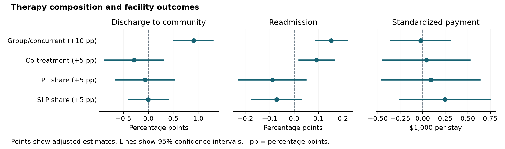

# Therapy mode and discipline mix in U.S. inpatient rehabilitation

How do facilities that deliver more therapy in groups compare on community discharge, readmission and Medicare payment? This study links four public CMS files covering 1,165 inpatient rehabilitation facilities. Among the 938 facilities with a usable case-mix profile, a higher share of group/concurrent therapy minutes was associated with both higher community discharge and higher readmission.



## Results

The table follows the first row of the figure across the three outcomes. Each estimate compares facilities whose group/concurrent share differs by **10 percentage points**, holding the other model variables fixed.

| Facility outcome | Adjusted difference | 95% confidence interval |
|---|---:|---:|
| Discharge to community | +0.90 percentage points | +0.51 to +1.30 |
| Readmission | +0.15 percentage points | +0.09 to +0.22 |
| Standardized Medicare payment per stay | −$23 | −$353 to +$306 |

The two rate associations met the Benjamini–Hochberg criterion across the 12 primary comparisons. The co-treatment estimate for readmission was smaller (+0.092 points per five-point higher share, adjusted q = 0.053). Intervals for physical therapy and speech-language pathology shares included zero for all three outcomes. [All 12 estimates and intervals](data/processed/mode_mix_post_audit/primary_12.csv)

One hypothesis for patient-level follow-up is that facilities using more group or concurrent therapy admit more patients with better baseline mobility who are more likely to return home. A second is that earlier discharge may be associated with more readmissions, which could be tested using linked records on length of stay, discharge destination and readmission.

## What the therapy measures capture

CMS records therapy minutes during the first two weeks of a rehabilitation stay. The original analysis divided these minutes by Medicare-covered days across the entire stay. Two facilities with the same recorded minutes could therefore have different ratios simply because their patients stayed different lengths of time. After reviewing the earlier results, I changed the question to the composition of minutes within the recording window.

Co-treatment has its own variable because two clinicians working with one patient describes a different encounter from group or concurrent therapy. The other two measures describe how minutes are divided among physical therapy, occupational therapy and speech-language pathology, with occupational therapy as the reference discipline. [Study design, CMS files and changes to the analysis](docs/study_design.md)

## Methods and sensitivity analyses

Each facility contributes one observation. The regressions adjust for patient mix, ownership, facility setting, stay volume and state fixed effects. Intervals use standard errors clustered across 51 state-level groups. The main analysis requires enough information to calculate each facility’s impairment mix. Two comparison models show how the results move when the eligible sample or the case-mix adjustment changes. [Main analysis code](src/12_mode_mix_analysis.py) · [Model comparisons](data/processed/mode_mix_post_audit/all_36_estimates.csv)

- **Influential facilities.** Removing one facility at a time gave group/concurrent estimates of +0.86 to +1.02 points for discharge across estimable deletions. [Model diagnostics](docs/model_a_diagnostics.md)
- **Sample selection.** Giving more weight to underrepresented settings and facility sizes moved the discharge estimate from +0.90 to +0.87 points. [Weighted regressions](docs/selection_weighted_regression.md)
- **Payment and therapy-share curves.** A Gamma regression estimated a $17 lower payment per stay for the same ten-point contrast. A separate spline analysis found little evidence of curvature for any outcome. [Payment comparison](docs/payment_gamma_sensitivity.md) · [Therapy-share curves](docs/group_share_nonlinearity.md)

## Limitations

Because community discharge and readmission are reported separately at the facility level, these data cannot show whether the same patients experienced both outcomes or how an individual patient would respond to a change in treatment. The outcome and therapy reporting periods overlap only partly. Smaller hospital-based units were more likely to have missing impairment data, and referral patterns and patient severity may still account for some of the observed differences.

## Reproduce the analysis

- **Current study (938 facilities).** Run `01` to clean and link the CMS files, `02` to build the database, then `12` to fit the therapy composition models.
- **Historical dose and screening analyses.** After `02`, run `04` and `05` with `--as-planned` for the original specification and again without the flag for the revised specification. The local script `06_compare_versions.py` compares the two sets of results and is planned for a later release.
- **Historical discharge function.** Run `09` after `02` to reproduce the exploratory estimates for discharge function, self-care and mobility. [Results and forest plot](docs/function_outcomes.md)

Place the [four CMS source files](docs/study_design.md#source-files) in `data/raw/`. From the repository root run:

```sh
python -m pip install -r requirements.txt
python src/01_data_quality_cms.py
python src/02_build_database.py
python src/12_mode_mix_analysis.py
python src/model_a_diagnostics.py
python -m unittest discover -s tests
```

The primary results are written to `data/processed/mode_mix_post_audit/` and figures to `reports/figures/`. Each linked sensitivity report includes its command. The [earlier dose analysis](data/processed/analysis/dose_primary_holm.csv) remains available for comparison.

## Acknowledgments

I led the study and drew on my rehabilitation experience to distinguish co-treatment from group and concurrent therapy. I used AI tools to help implement and check analyses and draft documentation, and I reviewed the results and their interpretation.

Shiting Zhang
