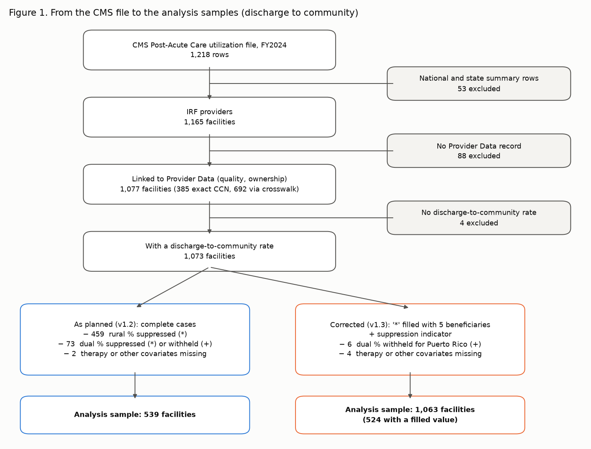
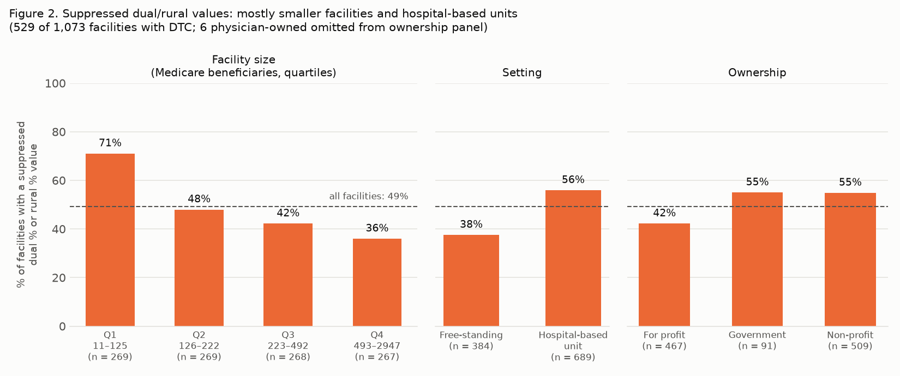

# Therapy Mode and Discipline Mix in U.S. Inpatient Rehabilitation Facilities

This project uses four public CMS datasets to study how rehabilitation therapy is delivered across **1,165 U.S. inpatient rehabilitation facilities (IRFs)**. The outcomes are discharge to the community, risk-standardized readmission, and standardized Medicare payment per stay. The analysis compares facilities, and its estimates describe associations.

## Research update

The original analysis studied treatment amount, format, and discipline mix. An audit found that the original dose ratio divided therapy minutes recorded in the first two weeks by covered days across the entire stay. Longer stays can therefore produce a lower ratio even when recorded therapy minutes are the same. The audit also found that the historical case-mix construction used the same fill for unavailable impairment counts and suppressed small counts.

The current research focuses on the composition of therapy minutes recorded in a common window. It distinguishes suppressed small counts from unavailable counts. In the **938-facility exploratory analysis**, a 10-percentage-point higher group/concurrent share was associated with a **0.904-point higher community-discharge rate** (95% CI 0.513 to 1.295) and a **0.153-point higher readmission rate** (95% CI 0.087 to 0.218). Both associations met the BH criterion in the current 12-comparison family. The measures have different implications for care quality. This focus was selected after earlier results were reviewed. The complete current analysis is maintained in the working project.

## Published workflow

| Step | Script | What it produces |
|---|---|---|
| 01 | [Clean and link CMS files](src/01_data_quality_cms.py) | Facility crosswalk, cleaning audit, and local analysis inputs |
| 02 | [Build the SQLite database](src/02_build_database.py) | Validated local database and schema |
| 03 | [Run descriptive SQL](src/03_execute_sql.py) | Seven [descriptive tables](data/processed/sql_outputs/README.md), including valid outcome counts for state summaries |
| 04 | [Fit the historical models](src/04_analysis.py) | Original dose ratios, sensitivity analyses, and readmission figures |
| 05 | [Run the historical screening demonstration](src/05_screening.py) | Aggregate flag counts, group rates, and bootstrap refit frequencies |
| 07 | [Check the historical models](src/07_model_diagnostics.py) | [Diagnostics report](docs/model_diagnostics.md), VIF, residual plots, and influence checks |
| 08 | [Draw the historical sample and suppression figures](src/08_figures.py) | Sample flow and missingness patterns |

Steps 07 and 08 document the earlier analysis, including the difference between the 539-facility original model and the historical correction for suppressed rural and dual-eligible values. The comparison exporter (06) and the current mode/mix model are part of a later release.





## Historical results

The [original 539-facility results](data/processed/analysis_as_planned/dose_primary_holm.csv) and [historical revised results](data/processed/analysis/dose_primary_holm.csv) are both available. In the historical revised models, the recorded-minutes/covered-day ratio had intervals including zero for community discharge and readmission. A 10-unit higher ratio was associated with about **$278 lower standardized payment per stay** (95% CI $154 to $401 lower). The mismatch between the recording window and denominator limits interpretation of this historical estimate.

The screening demonstration flagged 4 of 541 facilities under the original specification and 11 of 1,067 under the revised specification. Only 2 flags were shared. Eight revised flags came from facilities newly included in the sample. Bootstrap frequency describes how often a rule is triggered when models are refitted while observed facility outcomes are held fixed. Group-rate differences describe the screened sample. The rule lacks external validation for operational decisions.

The descriptive SQL reports **actual** Medicare payments. The regression results use **standardized** Medicare payments. The [SQL guide](data/processed/sql_outputs/README.md) explains this distinction and the state-level denominators.

## Quick start

Use the versions listed below and run from the repository root. Place the four unmodified CMS CSV files under `data/raw/` with these names:

| Local file | CMS dataset |
|---|---|
| `pac_irf_by_provider.csv` | [Medicare PAC utilization, IRF by geography and provider](https://data.cms.gov/provider-summary-by-type-of-service/medicare-post-acute-care-hospice/medicare-post-acute-care-utilization-inpatient-rehabilitation-facility-by-geography-and-provider), FY2024 |
| `irf_general_information.csv` | [IRF General Information](https://data.cms.gov/provider-data/topics/inpatient-rehabilitation-facilities), September 2026 refresh |
| `irf_provider_data.csv` | [IRF Provider Data](https://data.cms.gov/provider-data/topics/inpatient-rehabilitation-facilities), September 2026 refresh |
| `irf_conditions.csv` | [IRF Conditions](https://data.cms.gov/provider-data/topics/inpatient-rehabilitation-facilities), September 2026 refresh |

Tested with Python 3.14.4. Use a virtual environment with the pinned dependencies.

```powershell
python -m pip install -r requirements.txt
python src/01_data_quality_cms.py
python src/check_linkage.py
python src/02_build_database.py
python src/03_execute_sql.py
python src/04_analysis.py --as-planned
python src/04_analysis.py --check
python src/05_screening.py --as-planned
python src/05_screening.py
python src/07_model_diagnostics.py
python src/08_figures.py
```

For local runs, add `--show-current` to step 03 or 05 to locate the latest successful batch. Add `--as-planned` to step 05 to select the original specification. The repository includes aggregate result snapshots. Facility-level analytical cohorts, databases, and review lists are stored locally.

## Author

**Shiting Zhang** · Rehabilitation background and health data science. [GitHub profile](https://github.com/shitingzhang)

I designed the research questions and clinical comparisons, completed most of the source cleaning, and wrote the initial facility ID mapping. AI assisted with selected coding, debugging, writing, and GitHub workflows. I reviewed the analysis choices and results.
