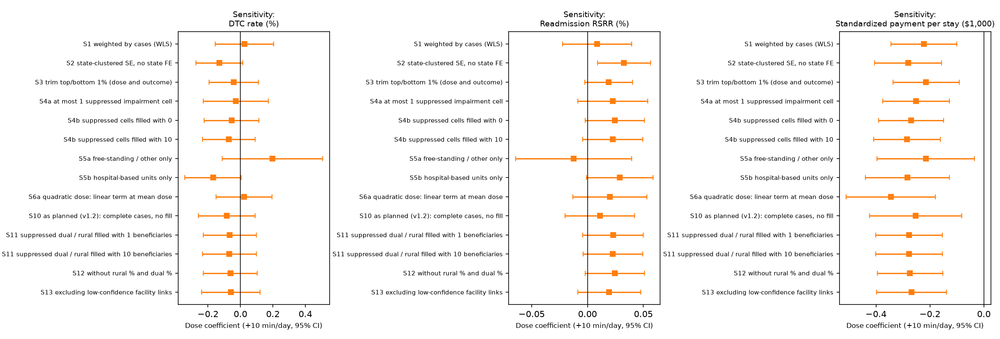

# Therapy Dose, Mode & Mix in U.S. Inpatient Rehabilitation Facilities


> Does **more therapy** — or a different **format** or **discipline mix** — go with better discharge outcomes or lower
> Medicare cost? A facility-level study of **1,165 U.S. inpatient rehabilitation facilities (IRFs)** using public CMS data,
> run under a pre-specified analysis plan with every later change logged.

## Key findings

- **No association was found** between daily therapy dose and **discharge to community** (−0.07 percentage points per
  +10 min/day, 95% CI −0.23 to 0.10) or **readmission** (0.02 points, 95% CI −0.004 to 0.05).
- Each extra **10 minutes of therapy per day** went with about **$280 lower** standardized Medicare payment per stay
  (95% CI $150–$400).
- All three results are **consistent in direction under the missing-data treatments tested**: as planned, corrected,
  alternative fill values, and without the affected variables.
- **Exploratory:** a higher share of group/concurrent therapy went with *higher* discharge-to-community **and** *higher*
  readmission rates. These are hypothesis-generating results, not adjusted for multiple comparisons.
- A **missing-data problem** removed 49.8% of facilities from the as-planned analysis. It was traced to CMS small-cell
  suppression, corrected, and **both versions are reported side by side**.

<p align="center">
  
  <br><em>Therapy-dose coefficient (+10 min/day, 95% CI) across the pre-specified sensitivity analyses.</em>
</p>

> **Associations, not causal effects.** The data are facility-level, observational and limited to Original Medicare. See
> [Limitations](#limitations).

## Contents

- [Research questions](#research-questions)
- [Tech stack](#tech-stack)
- [Quick start](#quick-start)
- [Project structure](#project-structure)
- [Data](#data)
- [Methods](#methods)
- [Results](#results)
- [Limitations](#limitations)
- [Transparency](#transparency)

## Research questions

| | Question | Type |
|---|---|---|
| **RQ-A** | Is a higher daily therapy dose (+10 min/day) associated with discharge to community (primary outcome), readmission and standardized payment per stay? | Confirmatory, Holm-adjusted |
| **RQ-B** | Holding dose fixed, are group/concurrent share, co-treatment share, discipline mix (PT/OT/SLP) and ownership associated with the outcomes? | Exploratory |
| **RQ-C** | Can a case-mix-adjusted screen flag facilities with a long length of stay *and* a low discharge-to-community rate? | Method demonstration |

## Tech stack

| Area | Tools |
|---|---|
| Data cleaning | Python, pandas: CCN crosswalk, suppression handling, rule-based audit log |
| Storage and queries | SQLite with typed tables and CHECK constraints; 7 descriptive SQL queries |
| Statistics | NumPy and SciPy: OLS/WLS with cluster-robust (CR1) standard errors written from scratch, Holm adjustment, bootstrap |
| Figures | matplotlib |

## Quick start

```bash
git clone https://github.com/shitingzhang/rehab-analytics.git
cd rehab-analytics
pip install -r requirements.txt

python src/02_data_quality_cms.py       # clean, link files, write audit log
python src/03_build_database.py         # build the SQLite database
python src/04_execute_sql.py            # descriptive SQL queries
python src/05_analysis.py --as-planned  # as-planned results (v1.2)
python src/05_analysis.py               # corrected results (v1.3)
python src/06_screening.py --as-planned
python src/06_screening.py
python src/07_compare_versions.py       # side-by-side comparison tables
```

Run from the project root. The cleaned facility file, the database and the facility-level screen files are rebuilt by
these steps and are not committed.

## Project structure

```
rehab-analytics/
├── data/
│   ├── raw/                     CMS source files (unchanged)
│   └── processed/
│       ├── analysis/            corrected results (v1.3)
│       ├── analysis_as_planned/ as-planned results (v1.2), kept unchanged
│       ├── comparison/          side-by-side tables of all versions
│       ├── screening*/          screen summaries (aggregate only)
│       └── sql_outputs/         descriptive query results
├── docs/
│   ├── analysis_plan.md         pre-specified plan + deviation log
│   └── work_log.md              step-by-step record of runs and decisions
├── reports/figures/             figures (as_planned/ for v1.2)
├── sql/                         schema and analytical queries
├── src/
│   ├── 02 … 07_*.py             pipeline
│   ├── irf_common.py            shared regression engine and variable construction
│   └── check_*.py               diagnostics (never look at outcomes)
└── legacy_synthetic/            earlier synthetic-data version (not used)
```

## Data

| Source (CMS) | Content | Version |
|---|---|---|
| Medicare Post-Acute Care Utilization, IRF by Provider | Stays, covered days, payments, beneficiary mix, therapy minutes by discipline and mode | FY2024, Original Medicare |
| Provider Data Catalog, IRF Provider Data | Discharge to community, readmission and other quality measures | Sept 2026 refresh |
| Provider Data Catalog, General Information and Conditions | Ownership; patients by impairment group | Sept 2026 refresh |

The files are linked by CMS Certification Number (CCN). Hospital-based units have a letter in position 3 in the quality
files but a digit in the utilization file; a data-driven crosswalk links 686 of them. Measurement windows differ:
utilization FY2024; discharge to community and readmission Oct 2023 – Sep 2025.

## Methods

- **Model:** OLS for each outcome, adjusting for therapy mode and mix, ownership, setting, case mix (risk score, age,
  dual-eligible %, rural %, impairment groups), log volume and state fixed effects. Standard errors are cluster-robust by
  state.
- **Confirmatory family:** the dose coefficient for the three outcomes, Holm-adjusted. Everything else is exploratory.
- **Sensitivity analyses (pre-specified):** case weighting, trimming, suppression fills, setting subgroups, non-linear
  dose, skewed group share, dose × ownership, and leave-one-state-out.
- **Validation:** the regression code was checked on simulated data with a known truth before it was run on real data.

## Results

### Why there are two versions

In the as-planned analysis (v1.2), only **539 of 1,073** facilities with a discharge-to-community rate were usable:
**534 (49.8%) were dropped** because rural % or dual-eligible % was missing. The dropped facilities were smaller and more
often hospital-based units.

The missing values are coded `*` in the raw file, the CMS marker for suppressed small counts.
[`check_suppression.py`](src/check_suppression.py) showed the following:
- **Dual %** met both checks for suppressed counts of 1–10 beneficiaries.
- **Rural %** met one check: shown values never imply fewer than about 11 beneficiaries, allowing for rounding. Its
  missing rate fell only slowly with facility size; the deviation log explains why that check was judged not to apply.

The corrected analysis (v1.3) fills each suppressed value with 5 beneficiaries and adds a "suppressed" indicator.
In the corrected samples, 49.3% of facilities have at least one filled value: dual % in 12.8%, rural % in 42.9%.

> **This change to the primary analysis was made after the as-planned results had been seen.** It is recorded in the
> [deviation log](docs/analysis_plan.md#12-deviation-log), and the as-planned results are reported alongside.

### RQ-A — Therapy dose (+10 min/day)

Coefficient [95% CI]. Discharge to community and readmission are in percentage points; payment is in $1,000 per stay.

| Outcome | As planned, v1.2<br>(n = 539) | **Corrected, v1.3**<br>**(primary)** | Fill = 1 | Fill = 10 | Without rural & dual % |
|---|---|---|---|---|---|
| Discharge to community | −0.084 [−0.260, 0.091]<br>Holm p = 0.68 | **−0.067 [−0.232, 0.097]**<br>Holm p = 0.42, n = 1,063 | −0.066 [−0.230, 0.097] | −0.068 [−0.234, 0.097] | −0.062 [−0.229, 0.104] |
| Readmission (RSRR) | 0.011 [−0.020, 0.042]<br>Holm p = 0.68 | **0.023 [−0.004, 0.050]**<br>Holm p = 0.19, n = 1,063 | 0.023 [−0.004, 0.050] | 0.023 [−0.004, 0.050] | 0.024 [−0.002, 0.051] |
| Payment per stay ($1,000) | −0.253 [−0.423, −0.083]<br>Holm p = 0.013 | **−0.278 [−0.401, −0.154]**<br>Holm p < 0.001, n = 1,065 | −0.277 [−0.401, −0.154] | −0.278 [−0.401, −0.154] | −0.274 [−0.396, −0.153] |

Across the other sensitivity analyses (figure above):
- The **payment** coefficient was negative, with a CI excluding 0, every time.
- The **discharge-to-community** coefficient changed sign in some analyses, and its CI always included 0.
- The **readmission** CI included 0 in all but one: state clustering without state fixed effects, 0.033 [0.009, 0.056].

### RQ-B — Exploratory associations

Not adjusted for multiple comparisons. A reporting rule was fixed before it was applied: a coefficient is reported only
if it has the same sign in both versions and its corrected 95% CI excludes 0.

<details>
<summary><b>Reported associations (14)</b></summary>

| Outcome | Term | As planned | Corrected [95% CI] |
|---|---|---|---|
| Discharge to community | Group/concurrent share (+10 pts) | 0.97 | 0.83 [0.46, 1.20] |
| Discharge to community | Dual-eligible % (+10 pts) | −1.47 | −1.13 [−1.66, −0.60] |
| Discharge to community | Stroke share (+10 pts) | 1.14 | 0.77 [0.27, 1.27] |
| Discharge to community | Nervous-system disorder share (+10 pts) † | 0.70 | 0.81 [0.30, 1.32] |
| Readmission | Group/concurrent share (+10 pts) | 0.16 | 0.14 [0.09, 0.20] |
| Readmission | Co-treatment share (+5 pts) | 0.12 | 0.08 [0.03, 0.14] |
| Readmission | Nervous-system disorder share (+10 pts) | 0.16 | 0.15 [0.05, 0.25] |
| Readmission | For-profit vs non-profit † | 0.13 | 0.23 [0.05, 0.40] |
| Payment ($1,000) | Hospital-based unit vs free-standing † | 0.49 | 1.08 [0.08, 2.08] |
| Payment ($1,000) | Non-traumatic brain disease share (+10 pts) | 1.37 | 1.03 [0.03, 2.03] |
| Payment ($1,000) | Nervous-system disorder share (+10 pts) | 0.46 | 0.34 [0.00, 0.67] |
| Payment ($1,000) | Spinal-cord share (+10 pts) | 1.64 | 1.60 [0.52, 2.68] |
| Payment ($1,000) | Stroke share (+10 pts) | 0.82 | 0.79 [0.09, 1.49] |
| Payment ($1,000) | log(Medicare stays) | −0.70 | −0.49 [−0.86, −0.12] |

† The 95% CI in the as-planned version included 0.

</details>

- **Depends on the missing-data treatment; not interpreted:** PT share of minutes and discharge to community: −1.26
  [−2.20, −0.32] as planned, 0.11 [−0.61, 0.84] corrected.
- **No association found** for the other 45 terms. The full three-version table is in
  [`comparison_summary.txt`](data/processed/comparison/comparison_summary.txt).

### RQ-C — Review screen (method demonstration)

A facility is flagged when its observed/expected length of stay is ≥ 1.20 **and** its discharge-to-community residual is
in the lowest quartile. Expected values come from case mix only. Stability is checked with 500 bootstrap refits.

| | As planned | Corrected |
|---|---|---|
| Facilities screened | 541 | 1,067 |
| Flagged | 4 | 11 |
| Flagged in ≥ 80% of bootstrap refits | 2 | 7 |

The screen is **unstable**: only 2 facilities are flagged in both versions. It is also **biased by size**: in the
corrected version the flag rate is 2.2% in the lowest volume tertile and 0% in the highest. **No facility-level list is
published**, and no facility should be described as inefficient on this basis.

## Limitations

- Facility-level, observational, cross-sectional data. Associations only, and they do not apply to individual patients.
- Original Medicare only; Medicare Advantage patients are not included.
- Measurement windows differ between the utilization and quality files.
- Unmeasured confounding (patient tolerance, medical complexity, referral patterns) and possible reverse relationships.
- Discharge to community and readmission are already risk-standardized by CMS, so further adjustment may partly
  double-count.
- How CMS counts concurrent/group minutes was not verified, so the 3-hour therapy rule is not used to judge facilities.
- The meaning of the CMS `*` marker (assumed: a count of 1–10) and of the `+` marker (8 Puerto Rico facilities, left
  missing) still has to be confirmed in the CMS documentation.
- Policy wording about IRF therapy rules was taken from summaries; the CMS sources listed in the plan should be read
  before any policy conclusion is drawn.

## Transparency

| File | What it shows |
|---|---|
| [`docs/analysis_plan.md`](docs/analysis_plan.md) | Pre-specified questions, models and sensitivity analyses, plus the deviation log |
| [`docs/work_log.md`](docs/work_log.md) | Every run, with its result and the decision taken |
| [`data/processed/analysis_as_planned/`](data/processed/analysis_as_planned/) | Full as-planned results, unchanged |
| [`data/processed/comparison/`](data/processed/comparison/) | Side-by-side tables of all versions |
| [`data/processed/audit_log.csv`](data/processed/audit_log.csv) | Every data-quality rule and the number of records it affected |

## Author

**Shiting Zhang** — rehabilitation background, working in health data science.
GitHub: [@shitingzhang](https://github.com/shitingzhang)
