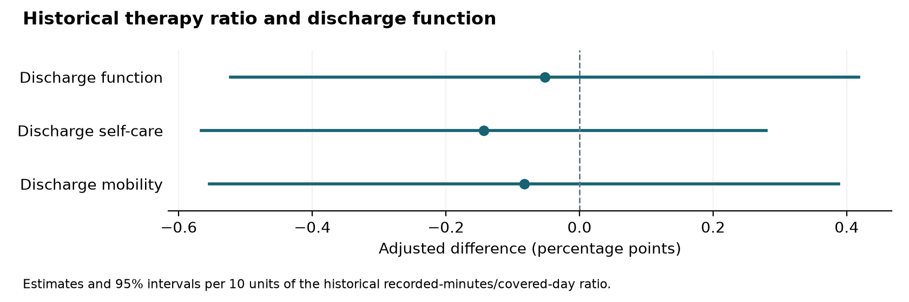

# Historical therapy ratio and discharge function

This exploratory analysis was added after the earlier dose results were known. It compares the share of patients meeting or exceeding their expected discharge score for function, self-care and mobility across 1,061 facilities.

| Outcome | Facilities | Adjusted difference (percentage points) | 95% CI | Holm-adjusted p |
|---|---:|---:|---:|---:|
| Discharge function | 1,061 | −0.0521 | −0.5225 to +0.4182 | 1.000 |
| Discharge self-care | 1,061 | −0.1436 | −0.5663 to +0.2791 | 1.000 |
| Discharge mobility | 1,061 | −0.0830 | −0.5538 to +0.3878 | 1.000 |

Each estimate compares facilities that differ by 10 units of the historical recorded-minutes/covered-day ratio. The regressions use the v1.3 adjustment variables and state fixed effects. Intervals use standard errors clustered by state, and Holm adjustment applies to the three p values in the table. [Primary result CSV](../data/processed/function_outcomes/dose_function_holm.csv)

All three primary intervals span zero. The sensitivity intervals also span zero, and weighting by the measure denominator shifts the function and self-care estimates from negative to positive. [Sensitivity results](../data/processed/function_outcomes/sensitivity.csv) · [Run summary](../data/processed/function_outcomes/function_summary.txt)

Therapy utilization covers FY 2024, and the function measures cover calendar year 2025. These measurements cover separate periods. The historical exposure also divides therapy minutes from the first two weeks by covered days across the entire stay. [How the therapy measures were defined](../README.md#what-the-therapy-measures-capture)

## Reproduce the analysis

After cleaning the CMS data and building the SQLite database with steps `01` and `02`, run `python src/09_function_outcomes.py` from the repository root. The script writes [six result files](../data/processed/function_outcomes/) and the forest plot.
