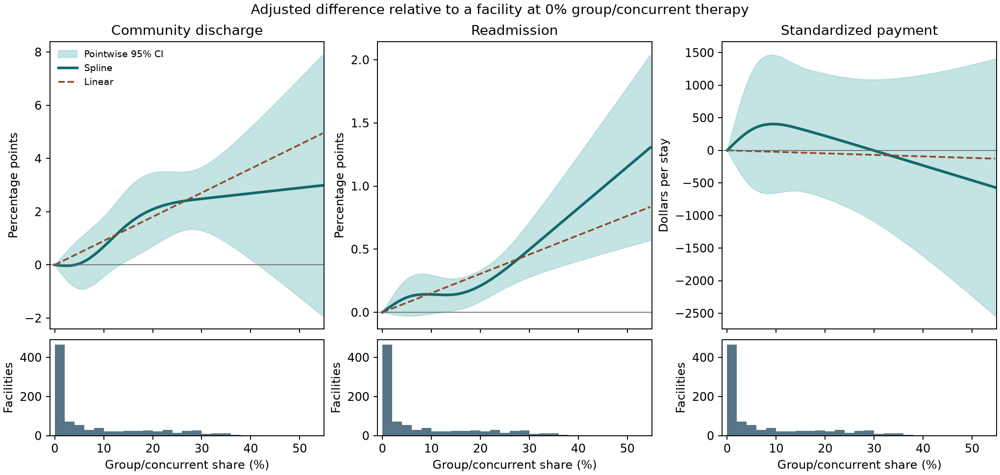

# Does the association change across the group/concurrent therapy range?

This post-results sensitivity analysis fits a restricted cubic spline in place of Model A’s linear group/concurrent term. The 0%, 5%, 15% and 30% knots were fixed before fitting the curves. Each fit uses the original facilities, other therapy shares, covariates, state fixed effects and outcome scale.

| Outcome | Facilities | State groups | Curvature F | Raw p | Holm p |
|---|---:|---:|---:|---:|---:|
| DTC | 938 | 51 | 0.603 | 0.551 | 0.782 |
| RSRR | 938 | 51 | 2.002 | 0.1458 | 0.4373 |
| PAY | 938 | 51 | 0.957 | 0.391 | 0.782 |

The state-clustered CR1 Wald F test compares the curve with a straight line by jointly testing two additional terms (2 numerator degrees of freedom, number of state groups minus one denominator degrees of freedom). Holm adjustment covers these three curvature tests. The original BH family covers the primary linear associations.

## Two ten-point comparisons

| Outcome | 0% to 10% [95% CI] | 20% to 30% [95% CI] | Second change minus first [95% CI] |
|---|---:|---:|---:|
| DTC | +0.688 [-0.435, +1.811] | +0.394 [-0.991, +1.780] | -0.294 [-2.332, +1.744] |
| RSRR | +0.142 [-0.012, +0.295] | +0.287 [+0.096, +0.477] | +0.145 [-0.124, +0.414] |
| PAY | +402 [-652, +1456] | -225 [-589, +139] | -627 [-1594, +340] |

The entries are adjusted facility-level differences. DTC and RSRR use percentage points. PAY uses dollars per stay. Each interval uses a state-clustered t critical value and the covariance of the full contrast. These pointwise intervals are unadjusted for multiple comparisons.

## Exposure support

| Outcome | Exactly 0% | (0, 5]% | (5, 10]% | (10, 20]% | (20, 30]% | Above 30% | Maximum (%) |
|---|---:|---:|---:|---:|---:|---:|---:|
| DTC | 191 | 379 | 92 | 119 | 117 | 40 | 54.69 |
| RSRR | 191 | 379 | 92 | 119 | 117 | 40 | 54.69 |
| PAY | 191 | 379 | 92 | 119 | 117 | 40 | 54.69 |

The curve is continuous at zero and constrained to be linear above 30%. The zero-width interval at 0% follows from using 0% as the reference. Histograms show the observed facilities in two-percentage-point bins. Sparse upper-tail data limit interpretation. The selected knots do not establish clinical thresholds.

Reproduce from the repository root with `python src/group_share_nonlinearity.py`. Checks compare the original linear estimate and interval with Model A and reproduce spline fits, curvature tests and contrasts using an independent natural-cubic interpolation basis.
