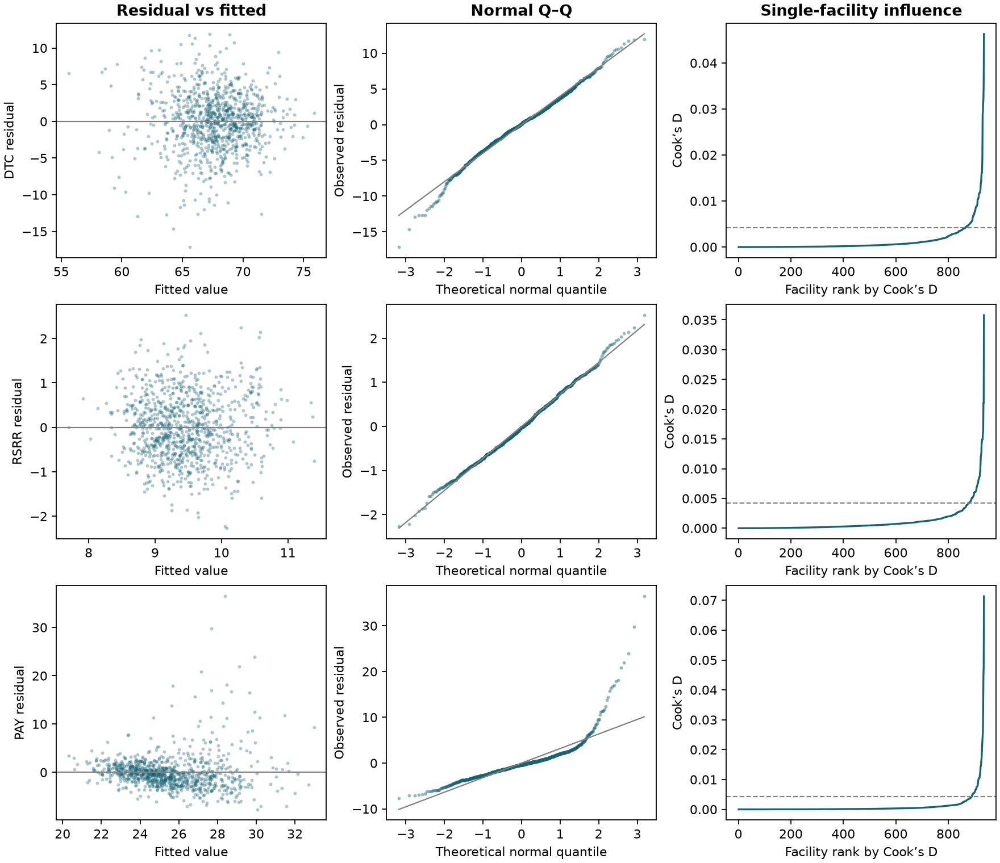

# Model A diagnostics

These post-results checks use the complete-composition sample, the original covariates and state fixed effects. All fitted coefficients, state-clustered CR1 standard errors and 95% intervals reproduced the saved Model A values within an absolute tolerance of 0.000001. See the [main estimates](../README.md#results).

## Residuals and influence

RMSE is the root mean squared residual in successive quartiles of fitted values. DTC and RSRR use percentage points. PAY uses thousands of dollars per stay. Excess kurtosis is zero for a normal distribution.

| Outcome | Facilities | State groups | Residual skew | Excess kurtosis | RMSE Q1 / Q2 / Q3 / Q4 | Cook’s D > 4/n | Max D | Unit leverage |
|---|---:|---:|---:|---:|---|---:|---:|---:|
| DTC | 938 | 51 | -0.27 | 0.96 | 4.85 / 4.13 / 3.72 / 3.09 | 71 | 0.046 | 2 |
| RSRR | 938 | 51 | 0.17 | 0.03 | 0.67 / 0.70 / 0.76 / 0.77 | 58 | 0.036 | 2 |
| PAY | 938 | 51 | 3.39 | 21.97 | 1.84 / 2.01 / 3.08 / 6.04 | 47 | 0.071 | 2 |

Cook’s D uses the full OLS design and residual mean square. The dashed line in the right column marks 4/n. The count identifies observations for closer inspection. Unit-leverage observations have undefined classical deletion diagnostics and are excluded from the Cook summaries and deletion ranges. All facilities contributed to the reported fit.

## Single-facility deletion

Ranges use the exact OLS deletion identity for each facility with leverage below one. They describe sensitivity of the point estimate to one facility at a time. They do not provide confidence intervals or measure the influence of deleting a whole state.

| Outcome | Exposure | Full estimate | Smallest deletion estimate | Largest deletion estimate |
|---|---|---:|---:|---:|
| DTC | group10 | +0.904 | +0.856 | +1.021 |
| DTC | cotreat5 | -0.289 | -0.452 | -0.191 |
| DTC | pt5 | -0.069 | -0.155 | +0.033 |
| DTC | slp5 | -0.004 | -0.054 | +0.036 |
| RSRR | group10 | +0.153 | +0.144 | +0.162 |
| RSRR | cotreat5 | +0.092 | +0.084 | +0.105 |
| RSRR | pt5 | -0.090 | -0.102 | -0.071 |
| RSRR | slp5 | -0.072 | -0.080 | -0.061 |
| PAY | group10 | -0.023 | -0.069 | +0.024 |
| PAY | cotreat5 | +0.041 | -0.050 | +0.178 |
| PAY | pt5 | +0.089 | -0.006 | +0.169 |
| PAY | slp5 | +0.246 | +0.124 | +0.396 |

## Collinearity within states

Each non-state predictor was centered within state and regressed on the other centered predictors. VIF is the ratio of its within-state sum of squares to its residual sum of squares. The four therapy terms appear first. PT and SLP use OT as the reference discipline.

| Predictor | DTC VIF | RSRR VIF | PAY VIF |
|---|---:|---:|---:|
| group10 | 1.82 | 1.82 | 1.82 |
| cotreat5 | 1.08 | 1.08 | 1.08 |
| pt5 | 2.48 | 2.48 | 2.48 |
| slp5 | 2.64 | 2.64 | 2.64 |
| for_profit | 1.68 | 1.68 | 1.68 |
| government | 1.16 | 1.16 | 1.16 |
| physician | 1.04 | 1.04 | 1.04 |
| unit | 2.88 | 2.88 | 2.88 |
| risk | 1.61 | 1.61 | 1.61 |
| age | 2.01 | 2.01 | 2.01 |
| dual10 | 1.72 | 1.72 | 1.72 |
| rural10 | 1.27 | 1.27 | 1.27 |
| dual_suppressed | 1.50 | 1.50 | 1.50 |
| rural_suppressed | 1.20 | 1.20 | 1.20 |
| log_stays | 2.87 | 2.87 | 2.87 |
| imp10_brain_disease_or_condition_non_traumatic | 1.63 | 1.63 | 1.63 |
| imp10_brain_injury_traumatic | 1.37 | 1.37 | 1.37 |
| imp10_hip_or_femur_fracture | 2.46 | 2.46 | 2.46 |
| imp10_hip_or_knee_replacement_amputation_or_other_bone_or_joint_condition | 1.90 | 1.90 | 1.90 |
| imp10_nervous_system_disorder_excluding_stroke | 2.39 | 2.39 | 2.39 |
| imp10_spinal_cord_any | 1.68 | 1.68 | 1.68 |
| imp10_stroke | 2.62 | 2.62 | 2.62 |

## Reproduction

From the repository root run `python src/model_a_diagnostics.py` after running the main analysis in `src/12_mode_mix_analysis.py`.
