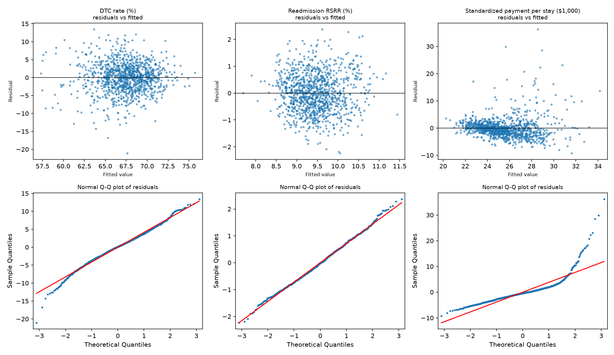

# Model Diagnostics

These diagnostics apply to the historical v1.3 models. The dose variable was a ratio of recorded first-two-week minutes to all covered days. Its time-window limitation is documented in the [project README](../README.md#research-update). Code: [`src/07_model_diagnostics.py`](../src/07_model_diagnostics.py);
full output: [`diagnostics_summary.txt`](../data/processed/diagnostics/diagnostics_summary.txt).

## 1. Estimator check

The hand-written OLS and CR1 cluster-robust standard errors (`irf_common.ols_cluster`) were compared with statsmodels
(`python src/04_analysis.py --check`). The pass criterion, set beforehand, was a maximum absolute difference below 1e-6.

| Outcome | Max coefficient difference | Max SE difference |
|---|---|---|
| Discharge to community | 3.1e-09 | 9.2e-10 |
| Readmission | 8.2e-10 | 6.6e-11 |
| Payment | 6.1e-09 | 4.0e-10 |

All three pass. The code had also been tested on simulated data with a known truth before it was run on real data.

## 2. Collinearity

The variance inflation factor (VIF) was computed for every non-state term, after removing state means (the state fixed
effects).

- **No term has a VIF above 5**; the largest is log(Medicare stays) at 3.0.
- Therapy dose: 1.11. HCC risk score: 1.59. Dual-eligible %: 1.66–1.68.

## 3. HCC risk score and dual-eligible %

The HCC risk score uses dual eligibility as one of its inputs, so the two overlap (facility-level correlation 0.34). Both
are kept: the risk score measures expected medical spending, while dual % also captures social and economic
circumstances that matter for going home. The dose coefficient barely moves when either is removed:

| Outcome | Primary | Without HCC risk score | Without dual % (and its indicator) |
|---|---|---|---|
| Discharge to community | −0.067 [−0.232, 0.097] | −0.065 [−0.234, 0.103] | −0.055 [−0.213, 0.103] |
| Readmission | 0.023 [−0.004, 0.050] | 0.023 [−0.003, 0.050] | 0.024 [−0.003, 0.050] |
| Payment ($1,000) | −0.278 [−0.401, −0.154] | −0.274 [−0.395, −0.153] | −0.276 [−0.398, −0.154] |

## 4. Residuals

| Outcome | Skewness | Excess kurtosis | Reading |
|---|---|---|---|
| Discharge to community | −0.28 | 1.25 | Close to normal; a slightly longer lower tail |
| Readmission | 0.14 | −0.02 | Close to normal |
| Payment | 3.14 | 18.7 | **Strong right tail**; spread grows with the fitted value |

For discharge to community and readmission, the OLS assumptions look reasonable. Their fitted values (about 57–76% and
8–11.5%) stay well inside 0–100%, so the linear model does not predict impossible values.

For **payment**, a small number of facilities are paid far more per stay than the model predicts, and the residual spread
is not constant. Three points follow:
- OLS still estimates the average association.
- Cluster-robust standard errors do not assume constant variance.
- The influence check below shows the direction is not driven by the extreme facilities.

A log-payment model would describe these data better, but it was not pre-specified. It is listed as a limitation rather
than run after the fact.

## 5. Influential facilities

Cook's distance was computed from the OLS fit, and the model was refitted without facilities with D > 4/n.

Two facilities are alone in their state (Alaska and Hawaii). The state effect fits them exactly: their leverage is 1,
their residual is 0 and they have no influence on the other coefficients. Their Cook's distance is undefined or
numerically meaningless, so they were kept. An early version of the script dropped them by mistake; this was corrected
before the results were read.

| Outcome | Primary | Without D > 4/n | Facilities removed | Largest D |
|---|---|---|---|---|
| Discharge to community | −0.067 [−0.232, 0.097] | −0.115 [−0.246, 0.016] | 79 | 0.04 |
| Readmission | 0.023 [−0.004, 0.050] | 0.023 [−0.003, 0.049] | 62 | 0.04 |
| Payment ($1,000) | −0.278 [−0.401, −0.154] | −0.201 [−0.298, −0.104] | 61 | 0.14 |

No single facility dominates: the largest Cook's distance is 0.14, far below the common warning level of 1. Removing all
facilities above 4/n leaves every conclusion unchanged:
- **Discharge to community:** the CI still includes 0.
- **Readmission:** the CI still includes 0.
- **Payment:** still negative, with a CI excluding 0. Without the high-payment outliers, the estimate is smaller: about
  $200 rather than $280 per +10 units of the historical recorded-minute/covered-day ratio.

## 6. What the model estimates

Discharge to community and readmission are already **risk-standardized by CMS** with CMS's own patient-level models. The
primary model adds further facility-level covariates: risk score, age, dual and rural %, and impairment mix. The dose
coefficient is therefore a **facility-level association conditional on these covariates, on top of CMS risk
standardization**. It is not an unadjusted total effect of therapy, and it is not an effect for individual patients.
Some adjustment may be duplicated; the ladder of models (M0 raw → primary) in `analysis_summary.txt` shows how the
coefficient changes as covariates are added.
